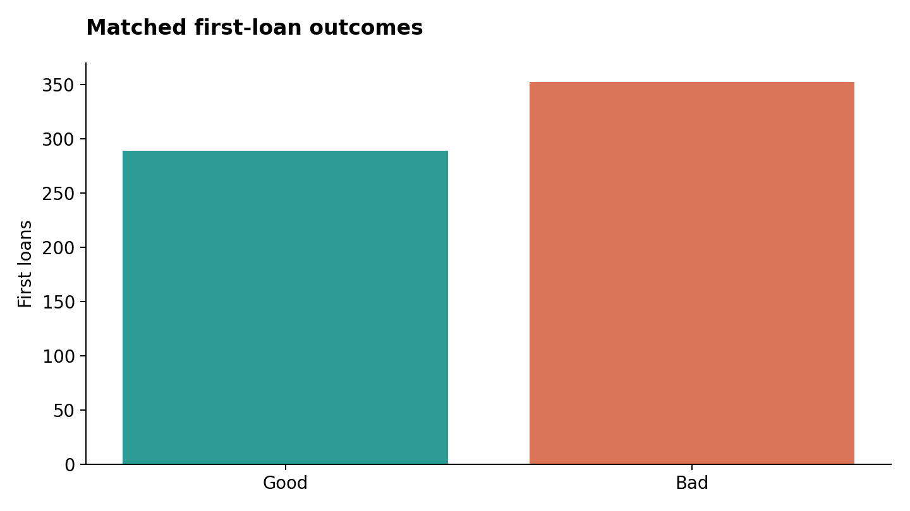
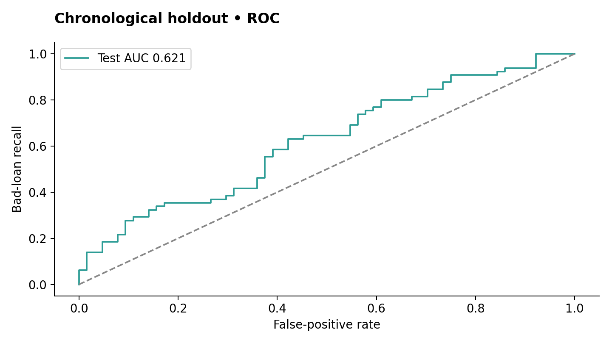
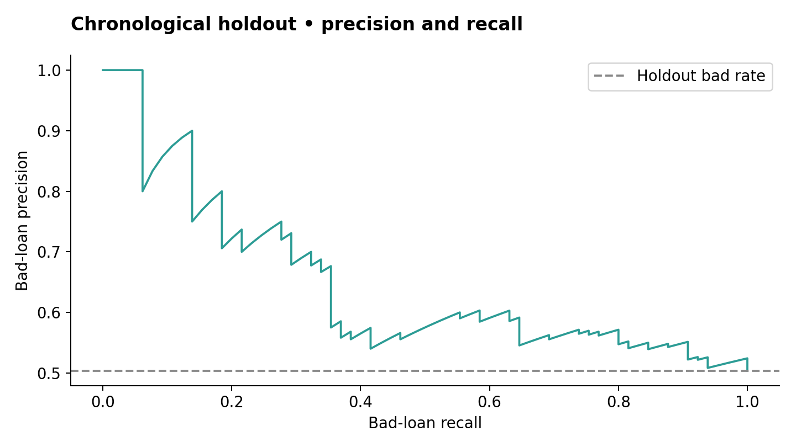
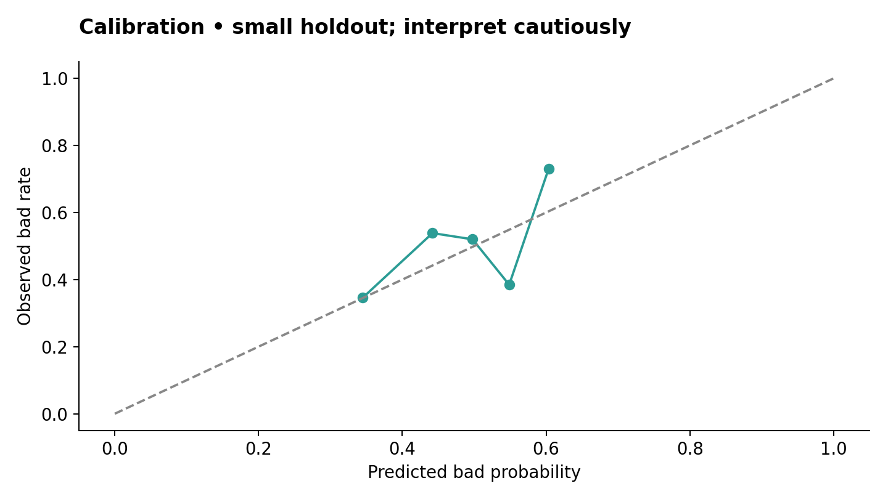
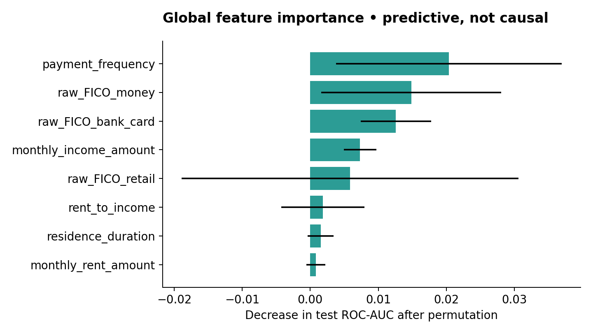

## LoanLens | End-to-end loan-risk project

Prepared for Anushka Jain | 14 October 2026 | Research application and reproducible findings

Decision: the supplied data supports a limited historical risk-ranking experiment, not a validated policy for issuing loans to current applicants. The application always requires human review. It never automatically approves or declines a loan.

The selected forest model scores ROC-AUC 0.621 on 129 later first loans. At the illustrative threshold 0.28, it identifies all 65 bad loans but also flags 62 of 64 good loans. This operational tradeoff is unsuitable for automated decisions. Infrastructure deployment remains unverified.

## 1. Problem definition and decision policy

The target is Bad=1 and Good=0, using the supplied flgGood label. The desired output is a risk probability for an application available at origination. No bad-loan definition, performance measurement date, observation horizon, interest/revenue, loss severity, recoveries, or business cost table was supplied. Therefore the model cannot establish expected profit or loss, set a justified approval cutoff, or identify all future applicants who should receive a loan.

Success is evaluated with ROC-AUC, average precision, precision/recall/F 1 for Bad, Brier score, calibration, and the confusion matrix against a constant-prior baseline. Accuracy alone would conceal the threshold tradeoff. All assessments are advisory and must undergo policy, affordability, and human review outside the model.

## 2. Dataset inspection and relationship validation

| Inspection | Observed result |
| --- | --- |
| Application Data | 647 rows; 31 original fields |
| Loan Performance | 1285 rows; 2 fields; 1269 customer prefixes |
| Dates | 2010-10-16 14:06:05 to 2011-04-17 21:15:49 |
| Mixed identifier types | 9 application IDs stored as integers |
| Matched first loans | 641 = 289 Good + 352 Bad |
| Excluded applications | 2 malformed IDs; 4 valid unmatched IDs |
| Repeat outcomes | 16 suffix -02 rows; 3 customers have differing labels |
| Unmatched first outcomes | 628 |

Normalize plausible customer IDs to lowercase strings and pad to 10 characters only after type conversion. Match customer_id to the prefix of idLoan, then select suffix -01. This yields a one-to-one merge validated explicitly. A naive case-sensitive join fails; a string-only join also drops integer IDs. Invalid or unmatched IDs are quarantined through counts, not silently assigned labels. Duplicate primary IDs or unexpected outcome labels cause ingestion to fail.

Crucial assumption: the prefix really denotes the same customer and -01 denotes the first loan. This is consistent with the data structure but cannot be proven without a source dictionary or owner confirmation. Repeated-loan labels are not attached to the first application. Application dates span roughly six months across seven calendar months, with partial endpoint months.

## 3. Data quality and EDA

All application status values are Approved. Missing values include payment_amount_approved (20), other_phone_type (285), how_use_money (2), and bank_account_duration (1). Most of these fields are excluded; retained missingness is handled within the fitted pipeline. Two matched borrowers report rent greater than income. Ages at origination range from about 18 to 80; date of birth is excluded from modeling and used only for the offline aggregate audit.

Score minima include L2C=50 and several FICO-family scores=222. Their meaning is unknown: special/sentinel codes versus valid low scores must be clarified before changing them to missing values. Numeric amount, income, rent, and score columns are bounded and checked for non-finite values at runtime. Inputs outside train-only ranges receive an explicit warning and human-review gate.

| Retained numeric input | Minimum | Median | Maximum |
| --- | --- | --- | --- |
| amount_requested | 250.0 | 500.0 | 800.0 |
| loan_duration | 2.0 | 5.0 | 8.0 |
| monthly_rent_amount | 0.0 | 550.0 | 3018.0 |
| monthly_income_amount | 300.0 | 2250.0 | 19392.0 |
| raw_l2c_score | 50.0 | 589.0 | 808.0 |
| raw_FICO_telecom | 222.0 | 568.0 | 712.0 |
| raw_FICO_retail | 222.0 | 594.0 | 756.0 |
| raw_FICO_bank_card | 222.0 | 671.0 | 797.0 |
| raw_FICO_money | 222.0 | 605.0 | 662.0 |

Currency, duration units, rent/own boolean semantics, and score-provider definitions were not supplied. The UI uses dataset units and excludes the ambiguous rent/own flag. No assumption is made that these historical, US-style credit fields are valid for Indian lending or INR amounts.

## 4. Processing, feature engineering and experiments

The 14 raw features are requested amount/duration; monthly income/rent; five raw scores; direct-deposit and ACH indicators; coarse residence/bank-account tenure; and payment frequency. Two derived features measure requested amount/income and rent/income. Excluded fields include customer ID, email, birth date, ZIP, bank routing, approval status/amount/duration/payment fields, payment amounts and counts with uncertain timing, email tenure, phone categories, and use-of-money text.

Numeric preprocessing uses median imputation, missingness indicators, and StandardScaler. Categories use most-frequent imputation and one-hot encoding with unknown categories ignored. Transformations are inside sklearn Pipeline/ColumnTransformer and are learned only from training folds. Scaling benefits logistic regression; tree models do not require it. No oversampling is used because matched outcomes are approximately 55% Bad rather than severely imbalanced.

| Partition | Rows | Use |
| --- | --- | --- |
| train | 384 | Candidate fitting + expanding-window CV |
| calibration | 64 | Sigmoid calibration of frozen winner |
| threshold_validation | 64 | Illustrative cost threshold selection |
| test | 129 | Untouched chronological evaluation |

| Candidate | Mean CV average precision | Mean CV ROC-AUC |
| --- | --- | --- |
| baseline | 0.580 | 0.500 |
| logistic | 0.646 | 0.568 |
| forest | 0.664 | 0.609 |
| hist_gradient | 0.650 | 0.580 |

Three expanding-window CV folds compare dummy baseline, regularized logistic regression, shallow random forest, and histogram gradient boosting. The forest wins on mean CV average precision. Calibration and threshold selection use separate 64-row validation subsets; both are small. Seeds are fixed to 42. JSONL tracks parameters/fold metrics; metadata captures source hash, split dates, versions, and exclusion reasons.

The threshold minimizes 5 x missed Bad + 1 x flagged Good on threshold-validation only. The 5:1 cost is illustrative and was not supplied by the lender. Test labels are not used to select a candidate, calibrator, or cutoff. Chronological splitting reduces random-split optimism, but missing label observation dates prevent verification that all earlier labels had matured before later applications.

## 5. Final holdout findings

| Metric | Selected model | Constant-prior baseline |
| --- | --- | --- |
| ROC-AUC | 0.621 | 0.500 |
| Average precision | 0.650 | 0.504 |
| Brier (lower is better) | 0.239 | 0.259 |
| Bad precision | 0.512 | 0.504 |
| Bad recall | 1.000 | 1.000 |
| Bad F1 | 0.677 | 0.670 |

| Actual / predicted | Not flagged | Flagged |
| --- | --- | --- |
| Good | 2 | 62 |
| Bad | 0 | 65 |

The holdout contains 65 Bad and 64 Good loans. The selected operating point flags 127 of 129 loans. Specificity is 2/64 = 3.1%. Bootstrap ROC-AUC 95% interval is 0.522-0.713. This resampling interval is conditional on the observed sample and fixed model; it does not capture dataset-selection, temporal, model-selection, or target-definition uncertainty.

## 6. Calibration and explainability

Sigmoid calibration is fitted on the frozen forest using its own validation subset. The test calibration curve uses five quantile bins, approximately 26 observations each. With this small sample, probability reliability is uncertain. Brier improves over the prior baseline but does not establish production calibration.

Global permutation importance measures change in holdout AUC after shuffling a feature; correlated predictors can share or obscure importance. Error bars show variability over 10 shuffles, not confidence in a causal effect. Small importances are unstable. Runtime reference comparisons replace one numeric input with its training median and recompute risk. They are transparent model sensitivities, not causal effects, SHAP values, or formal adverse-action reasons.

## 7. Responsible AI and limitations

Removing direct identifiers and age from training does not guarantee fairness: scores, tenure, income, and payment methods may act as proxies. Only a limited offline age-band comparison is possible. No sex, race, disability, reliable region, or other relevant demographic audit dataset was supplied. Assess legal/policy applicability with a qualified domain owner before a lending release.

| Age at origination | Holdout rows | ROC-AUC | Bad recall |
| --- | --- | --- | --- |
| Under25 | suppressed | not estimated | not estimated |
| 25to39 | 44 | 0.439 | 1.000 |
| 40plus | 76 | 0.696 | 1.000 |

The age 25-39 group has AUC 0.439 (44 records) versus 0.696 for age 40+ (76 records); under 25 is suppressed because there are fewer than 20 observations. These unstable descriptive differences deserve investigation and cannot certify fairness or establish discriminatory causation. Recall equality at the almost-all-flagged cutoff is not evidence of fair treatment.

Major limitations: very small data; only historically approved borrowers; unmatched outcome coverage; source-relationship ambiguity; repeat-loan ambiguity; obsolete 2010-2011 population; undefined Bad/horizon; incomplete point-in-time feature/label provenance; unknown score sentinels; unknown currency/units; narrow amount range; uncertain calibration; cost-sensitive threshold dominated by false positives; no prospective evaluation or population fairness validation.

Additional useful data: contemporary application and origination IDs; decisions/declines with legally/ethically observable outcomes; matured delinquency definitions and observation dates; source field timestamps; verified income/employment and existing debt/obligations; affordability; bureau history/sentinel dictionary; interest/fees, loan exposure, realized losses, recovery and funding costs; acquisition channels; demographic audit fields governed separately from prediction features; macroeconomic context; consent/retention metadata.

## 8. Connected application and future requests

FastAPI serves the frontend and JSON APIs from one origin. Create a private account, fill the 14-field form or load synthetic values, assess, view probability/range warnings/reference comparisons, record outcomes, monitor, and delete an assessment/account. Batch JSON supports up to 50 applications with a 64 KiB body cap. The backend runs the packaged model; no client-side risk formula or fabricated API result is used.

The model loads once in lifespan. A SHA-256/runtime check precedes loading; only trusted operator-controlled joblib files are permitted. JSON registry/version snapshots preserve research releases. Future requests always use the frozen deployed version; no background training alters a live model. Retraining is an offline controlled release, requiring renewed evaluation and report review.

Account-only monitoring computes PSI on train-derived numeric bins after 20 predictions, with an illustrative 0.2 alert. After 20 labeled predictions and both classes, it reports AUC/Brier. Feedback is user-reported/unverified and never automatically enters training. Monitoring therefore detects signals, not definitive population drift or validated realized lending performance.

Optional Hugging Face chat explanation is server-side, disabled by default, and consent-based. It receives only a coarse risk band and feature names. Scoring requires no external AI service. HF free-tier availability/quotas and model support are account-dependent. No live HF token was provided; provider request minimization and failure behavior were tested with stubs.

## 9. Security, privacy and testing

Passwords are Argon2id-hashed; opaque session cookies are HttpOnly/SameSite=Strict and Secure in production. Origin/CSRF checks protect writes; database-backed atomic limits protect login/signup/model calls. No admin role, default accounts, uploads, password reset, analytics, browser storage, public Swagger, arbitrary file server, or third-party payment service exists. SQLAlchemy binds query parameters; DOM renders output with textContent. Live account deletion cascades sessions/assessments/outcomes.

| Collected data | Stored / external destination |
| --- | --- |
| Account email | Application DB; not sent externally |
| Password | Salted Argon2id hash only in DB |
| Financial input/score/tenure fields | Caller-owned prediction JSON; no AI prompt export |
| Session / CSRF | Keyed token digest and session expiry; protected cookie/in-memory CSRF |
| IP | Transient; only HMAC rate-limit pseudonym persisted |
| Optional explanation | HF receives band + feature names + service authentication/network metadata |

No real source secrets were found. DATABASE_URL, AUTH_SECRET, DB bootstrap/app passwords, and optional HF_TOKEN are environment-only. .env/certificates/raw borrower files are excluded from source/build archives; a blank .env.example documents configuration. No inherited Git history was supplied. Rotate any previously hardcoded secrets immediately, because old history/images/caches retain them.

The complete per-check audit and attack/data-flow maps are in security_privacy_audit.md. Application responses have generic errors/correlation IDs, no-store, nosniff, DENY, one-year HSTS, and self-only-script CSP. Production startup rejects missing critical settings, SQLite, plaintext/unverified PostgreSQL TLS, and non-HTTPS/wildcard origins.

Validation: 43 tests passed against the live FastAPI TestClient with a disposable SQLite adapter. Tests include ownership, anonymous APIs, expired/tampered sessions, Argon 2, Secure-cookie configuration, CSRF/CORS, role injection, SQL/script-shaped input, rate boundaries, payload/batch limits, data deletion, error/log redaction, monitoring, provider minimization/timeouts, and model contract/integrity. JavaScript syntax was checked. HTTP smoke-test and secret-scan evidence are bundled when available.

## 10. Deployment and release gates

Delivered: Dockerfile, development PostgreSQL Compose, production Compose with Caddy HTTPS/private DB and verified PostgreSQL TLS, separate non-superuser DB app role, environment generator, local SQLite launcher, and daily retention worker. App/db ports are private in production; only the edge publishes 80/443. The fixed trusted proxy address prevents indiscriminate X-Forwarded-For trust. Production requires operator-supplied domain, certificates, environment values, encrypted storage, and backup policy.

Not verified here: Docker build/runtime, actual PostgreSQL queries/cascades/TLS/grants, public HTTPS/proxy behavior, live Hugging Face, dependency CVEs, browser E 2 E/accessibility, concurrency/load, encrypted backups, and restore/deletion handling. There is no public deployment URL. Worker-only native hosting cannot run this Python/PostgreSQL application. The package is runnable locally and deployable to a suitable host after these checks, not certified production-ready.

Live predictions expire after 90 days under the supplied production retention worker; sessions expire after one hour; rate pseudonyms expire by their window. Account data remains until deletion. Backups require encrypted storage, a maximum 30-day policy, and tombstone/reapplication controls after restores. Immediate third-party/provider or backup deletion is not implemented. Infrastructure privacy settings are operator responsibilities.

Next evidence-driven step: confirm source semantics and obtain current, representative, matured lending data; define costs/affordability and human policy; validate subgroup performance and probability calibration prospectively. Only then consider an independently governed loan-decision policy. This project presents its weak findings honestly and keeps an unconditional human-review gate.

## References and reproducibility

Source: supplied AssessmentDataScientist(2).xlsx; Application Data + Loan Performance sheets. Raw workbook and borrower identities are not included in the release archive.

Source SHA-256: b626e74d686358828fde6a7d619d320b8a01ca8a486ea8e0ea98420cb3bffc69

Model version: a43bd07d2dc4; SHA-256: a43bd07d2dc485656484ea815f15790ff7baf26a5d5575b08f32bf1b206001d7

scikit-learn: https://scikit-learn.org/stable/common_pitfalls.html

Calibration: https://scikit-learn.org/stable/modules/calibration.html

FastAPI lifespan: https://fastapi.tiangolo.com/advanced/events/

HF client: https://huggingface.co/docs/huggingface_hub/package_reference/inference_client

PostgreSQL TLS: https://www.postgresql.org/docs/current/libpq-ssl.html

Caddy proxy: https://caddyserver.com/docs/caddyfile/directives/reverse_proxy
